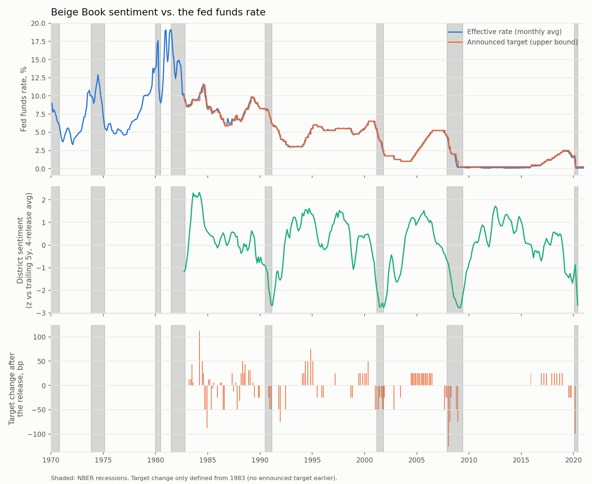

# Beige Book

We use several off-the-shelf text sentiment analysis tools to analyze the sentiment of the Fed's Beige Book reports from 1970--2020.

The raw text data is scraped from the [Minneapolis Fed](https://www.minneapolisfed.org/region-and-community/regional-economic-indicators/beige-book-archive) by `scrape.py` and stored in `txt`. Do whatever you want with this data (I clearly do not own the copyright).

The reports are scored in `sentiment.py` using three pre-trained models. I am in the process of adding more. So far the models used are

- VADER from `NLTK`
- Pattern analyzer from `TextBlob`
- LSTM text classifier from `flair`

The analysis is done in `analysis.py`, where we get the following graphs:


## Predicting the fed funds target

Can the sentiment of a Beige Book predict the FOMC's target-rate decision at the meeting ~2 weeks later?

```
python rates.py      # sanity-check the target series (Data/*.csv from FRED: FEDFUNDS, DFEDTAR, DFEDTARU/L)
python lmscore.py     # LM + directional scores -> out/csv/lm_scores.csv
python features.py   # one row per release -> out/csv/features.csv
python predict.py    # walk-forward models -> out/csv/predictions.csv, out/csv/model_scores.csv
python plots_ffr.py  # out/figs/sentiment_vs_ffr.png, out/figs/model_oos.png
```

Setup: for each release we record the target in effect that day and the target 21 days later (before the next release);
the difference is the outcome. Features are the 3-scorer composite sentiment (district mean, national summary, cross-district
dispersion), z-scored against a *trailing* 5-year window so there is no look-ahead, plus lagged policy moves. Models are refit
at every release using only earlier data (1995-01 to 2020-05, 204 releases).




Findings (out-of-sample, 1995--2020; full numbers in the next section):

- Sentiment has real signal: it beats "always hold" on squared error, driven by the district-average score.
- Once predictions respect the zero lower bound (below), sentiment adds significantly to lagged policy moves alone.
- The edge comes mostly from the 2001 and 2007--09 easing cycles. The 2020 COVID cuts are missed by every model.
- On absolute error (bp) the models only barely beat "repeat the last move" (best: 8.7bp vs 8.9bp); they are better at spotting big cuts than at calling routine 25bp moves.

### Domain-specific scorers (`lmscore.py`)

The generic scorers were tried against two alternatives, computed per sentence from `txt-split/`
(needs `pip install pysentiment2`, which bundles the Loughran-McDonald finance dictionary):

- `lm_net`: Loughran-McDonald net tone.
- `dir_act` / `dir_price`: up-vs-down direction words ("rose", "declined", ...) with negation flipping, scored separately on
  activity sentences and on price/wage sentences. These word lists are hand-written (see the top of `lmscore.py`), not a published lexicon.

### Zero lower bound

With the target pinned at ~0 (Dec 2008--Dec 2015, and Apr 2020 on) sentiment cannot move policy, and the first version of the model
kept predicting hikes/cuts anyway (sentiment *hurt* in 2009--2019). Two fixes, both using only information available at release time
and applied to every model so the comparison stays fair:

1. **Floor:** a prediction can never be a cut larger than the distance to the bound (no cuts when the target is at 0.25%).
2. **Gating** (`g_*` feature sets): a `zlb` dummy, and the sentiment features are zeroed while the target is at the bound.

Walk-forward 1995--2020, ridge, R² of squared error vs "always hold" (all with the floor):

| features | full | excl. 2020 | 2009--2019 |
|---|---|---|---|
| policy state only | 0.30 | 0.32 | 0.13 |
| + VADER/TextBlob/Flair | 0.38 | 0.42 | 0.03 |
| + directional activity & price tone | 0.42 | 0.47 | 0.04 |
| + VADER/TextBlob/Flair, **gated** | 0.40 | 0.44 | 0.18 |
| + directional activity & price tone, **gated** | 0.43 | 0.48 | 0.15 |

(Before the floor, state-only scored 0.26 / 0.30 / -0.11 and the sentiment models were negative in 2009--2019.)

Squared-error gain over state-only, block bootstrap (`predict.robustness`), bp² per release, 95% CI:

- existing scorers: +39 [+1, +85]; directional tone: +56 [+15, +106] (full sample; same excl. 2020).
- gating on top of the floor: +3 to +7, CI includes 0 (borderline, p ~ 0.03--0.12), mostly in 2009--2019.

Notes:

- LM tone is the weakest single scorer. All activity-type scorers are highly correlated (directional activity vs. the original district average: r = 0.91), so they mostly measure the same business-cycle factor. The price-direction score is the most distinct one.
- The "lean" feature sets and the ZLB treatment were chosen *after* seeing earlier results (forking paths), and many specs were compared without multiple-comparison correction. Treat p-values as exploratory. The clean test is data after 2020-05, which this repo does not yet have.
- Not shown in the table: gradient boosting (`gbm_*` in `out/csv/model_scores.csv`) gives similar results; `gbm_state` is already strong in 2009--2019 (0.30) so the gating matters less for it.

Caveats: the FOMC only announced its target from Feb 1994 (earlier values are the Fed's reconstruction); before 1982-09 there is no
target, so pre-1983 data is only used for the descriptive plot and for warm-up of the rolling normalisation. After Dec 2008 the upper bound
of the target range is used. Only ~100 non-hold decisions exist, so treat all results as suggestive.

## Interactive dashboard

`dashboard/` holds the source of an interactive dashboard that summarises the findings above (period, scorer and model pickers; timeline, scatter, model scores, forecast and bootstrap-gain charts).

```
python3 dashboard/build_data.py dashboard/data   # after predict.py: JSON data files from out/csv/
```

`dashboard/index.html` is the page. It was published as a Claude Artifact of the Data type, which reads the five JSON files as datasets
(`releases`, `predictions`, `period_scores`, `gains`, `scorers`). The sub-period scores, bootstrap intervals and correlations are computed in
`build_data.py`, so the page only displays them. The published copy is a snapshot: re-run the build and re-upload the files to refresh it.

## Dependencies

Dependencies are listed in `requirements.txt`. Tested + Developed on Python 3.8.

- `scrape.py`
  - `requests`
  - `beautifulsoup4`
- `files.py`
  - `pandas`
- `clean.py`
  - `cleantext`
- `sentiment.py`
  - `pandas`
  - `nltk`
  - `textblob`
  - `flair`
  - `transformers`
- `analysis.py`
  - `numpy`
  - `pandas`
  - `statsmodels`
  - `matplotlib`

## TODO

- [x] Fix parsing errors
  - [x] Bug with `<br>` tag instead of `<br />` (no more breaks)
  - [x] Remove `<strong>` (ignored)
  - [x] `&nbsp;` problem (check if this gets removed)
  - [x] Delete "learn more" `<p>` at the bottom (`grep -RIl "www\." txt/`)
- [x] Find missing/incomplete files
  - [x] Some files are empty
  - [x] Analyze `errors.txt`
- [x] Grab missing files
  - [x] Grab missing `2016-0(4|6)-su` files
  - [x] Grab missing `2015-07-*` files
  - [ ] Try to find missing `1971-01-bo`
- [x] Clean text
  - [x] Replace `&%-+` with text?
  - [ ] Replace numbers with words
  - [x] Check that text is ASCII
- [x] Run sentiment analysis
  - [x] Check out `flair` package
  - [x] `flair` gives values `x<-0.5 | x>0.5` (fixed in analysis)
  - [ ] Check if all text is used or just first `n` words
  - [ ] `transformers` package
  - [ ] Just extract numbers (bigger is better)
- [x] Get exact dates of publication
- [x] Generate histograms
  - [x] Normalize values
  - [x] Check out outlier (`1971-01-bo` missing doc)
- [x] Regress national sentiment on regional sentiments
  - [ ] Do you add a constant here?
  - [ ] See if coefficient sum to 1
  - [ ] Create proxy measure including all regions
- [x] Graph time series
  - [x] Pretty up plots (title+legend)
  - [x] Get GDP data
  - [x] Check stock market data
  - [ ] Think about timing of Beige Book data
  - [x] By region in a grid
  - [ ] Bond yields
- [ ] Time series regression
- [ ] Investigate discrepancies between sentiment scores
  - [ ] In `su` `TextBlob` is high during 1974 recession and higher during 1990s boom
- [x] Add info + pictures to `README.md`
- [ ] GDP Growth by region
  - [ ] Aggregate state data
